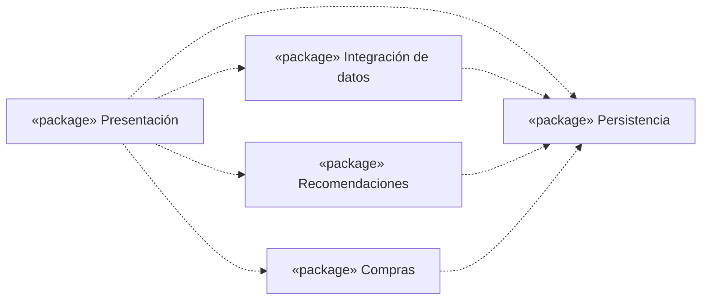
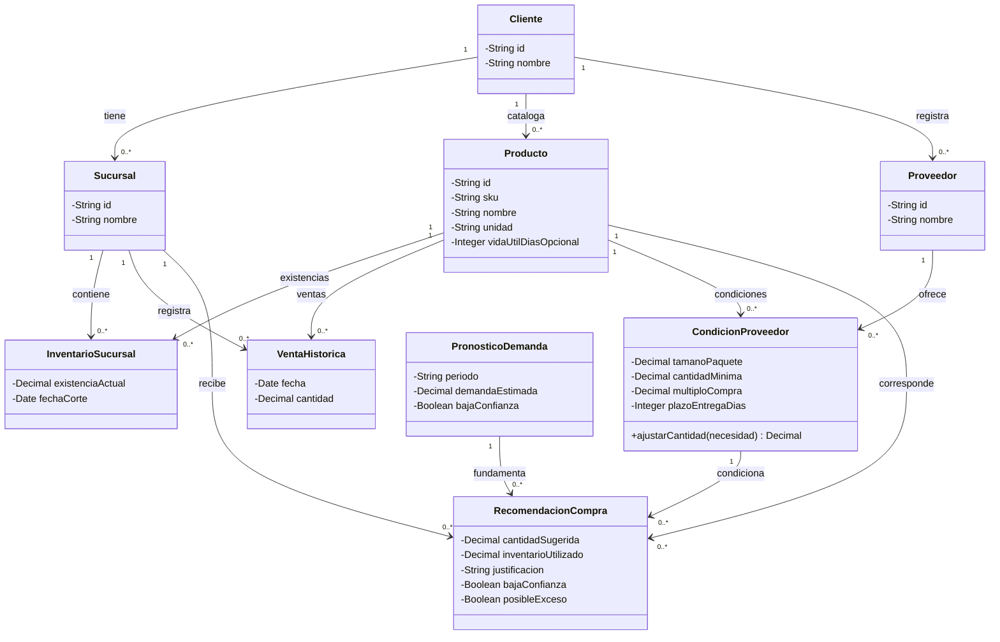
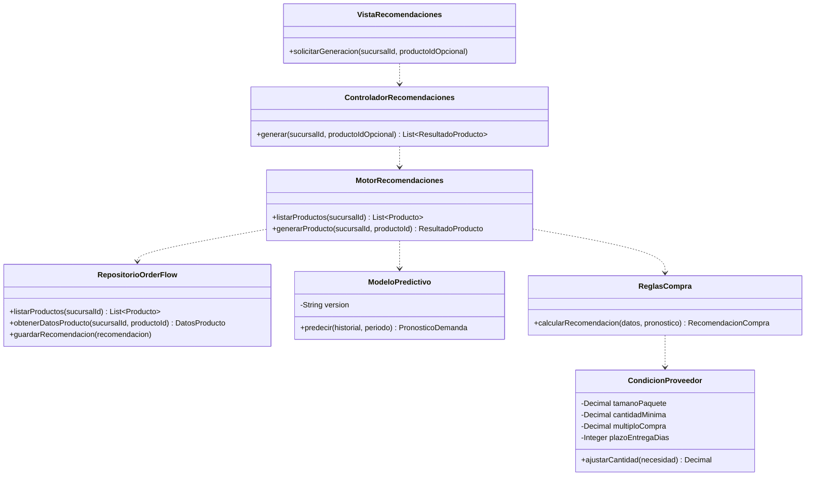
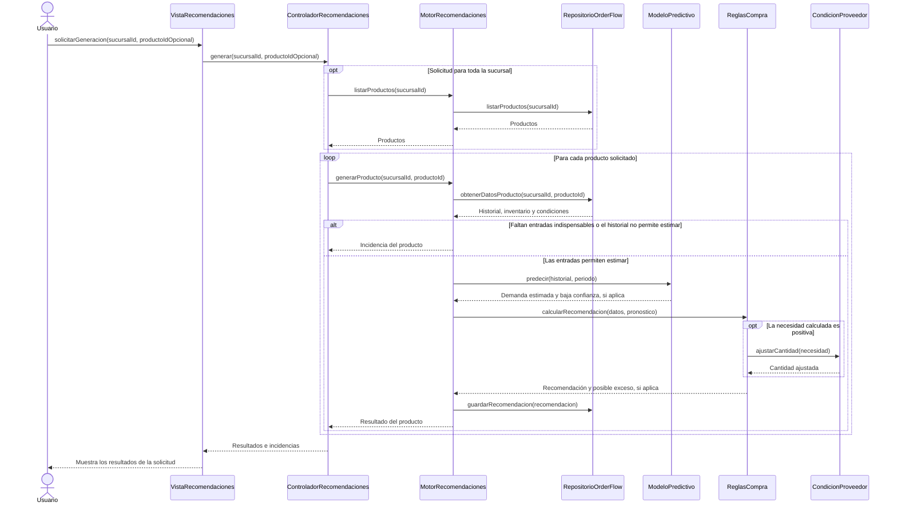
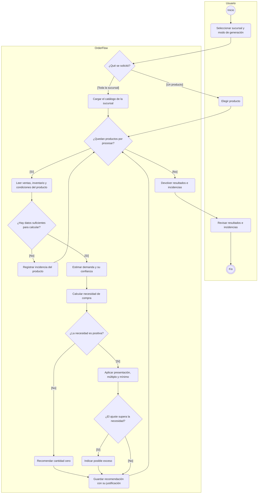

# Modelo UML de OrderFlow

El flujo principal desarrolla [CU-03](../../docs/especificacion-requisitos.md#53-caso-de-uso-detallado--cu-03-generar-recomendaciones-de-compra). CU-04 consulta las recomendaciones guardadas y CU-05 agrupa una selección en listas por proveedor.

## Paquetes de la aplicación

Cada paquete corresponde al componente del [nivel 3 de C4](diagramas.md#c4-nivel-3--componentes-de-la-aplicación-web). El diagrama usa la notación de flujo de Mermaid para representar dependencias entre paquetes.

## Clases

El modelo de clases tiene una vista de dominio y otra de las operaciones de CU-03. Las cantidades usan valores decimales para admitir unidades como kilogramos. Cada recomendación conserva el producto, la sucursal, la condición de compra aplicada y la justificación.

### Entidades de dominio

### Clases que colaboran en CU-03

Las flechas punteadas representan dependencias de uso. CondicionProveedor también aparece en la vista de dominio.

El repositorio entrega DatosProducto, que reúne el historial de ventas, el inventario, las características del producto y la condición de compra aplicable. ResultadoProducto identifica el producto y contiene una recomendación o el motivo por el cual no pudo calcularse.

## Secuencia · CU-03 Generar recomendaciones

La secuencia usa llamadas con los mismos nombres que las operaciones de clases. Por ejemplo, el mensaje «generarProducto(sucursalId, productoId)» llega a **MotorRecomendaciones**, donde se declara esa operación. El modo sucursal aporta varios productos al mismo ciclo.

## Actividad · CU-03 Generar recomendaciones

Las calles muestran las acciones del usuario y de OrderFlow. Cuando el usuario solicita todos los productos, una incidencia llega a la salida del producto y el flujo avanza al siguiente. El cálculo de necesidad considera inventario, entrega y caducidad cuando aplique. Una solicitud de sucursal con catálogo vacío devuelve el conjunto vacío e informa el motivo.

