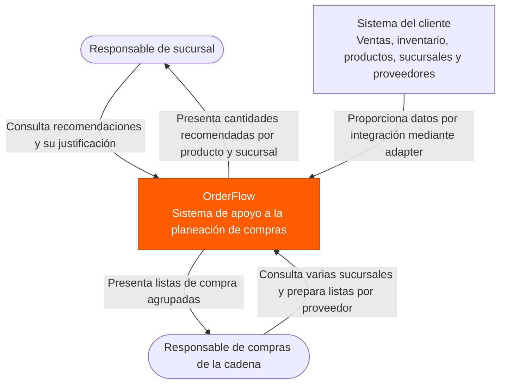
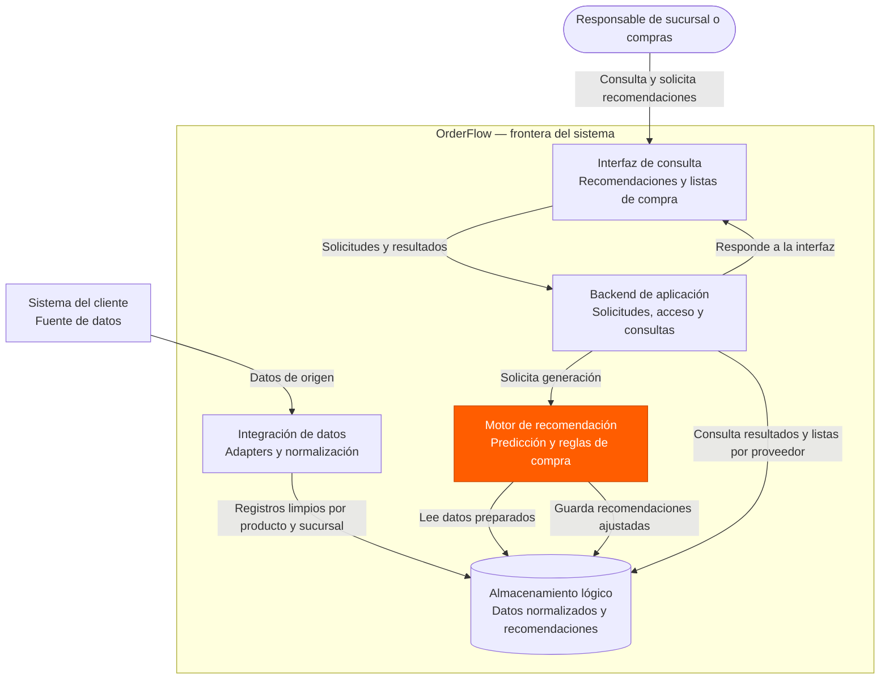
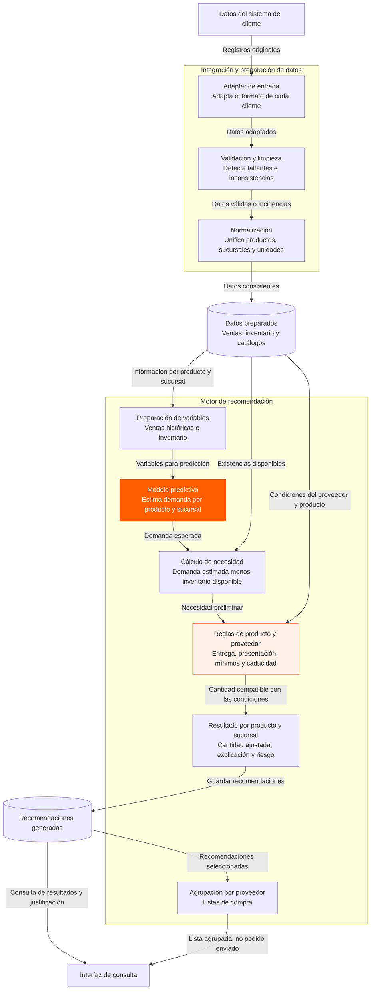
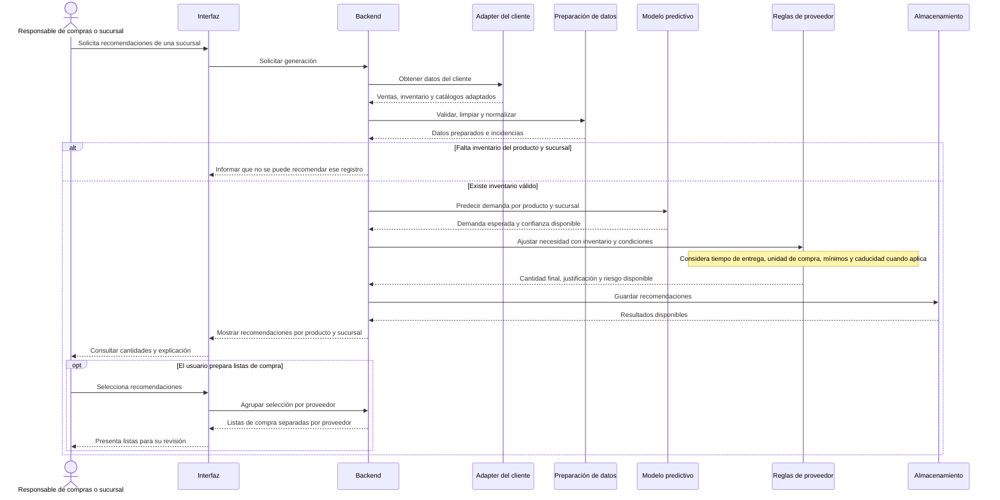

# Diagramas de arquitectura — OrderFlow

**Proyecto:** OrderFlow  
**Materia:** Ingeniería de Software I · SIS3407  
**Formato:** Mermaid renderizable en GitHub  
**Base documental:** `especificacion-requisitos.md`, versión 1.1 (22/09/2026), y descripción del funcionamiento actual proporcionada por el responsable del proyecto.

## Criterio de modelado

OrderFlow **no administra los movimientos operativos de inventario ni compra automáticamente a proveedores**. Obtiene información del sistema del cliente mediante un *adapter*, valida, limpia y normaliza los datos, calcula la demanda mediante un modelo predictivo y obtiene recomendaciones de compra **por producto y sucursal**. Después aplica restricciones del producto y del proveedor, y permite consultar recomendaciones y preparar listas de compra agrupadas por proveedor.

Los diagramas representan la **arquitectura lógica propuesta a partir del comportamiento descrito**, no una auditoría del código implementado. Como no se indicó un lenguaje de programación, framework, motor de base de datos o protocolo de integración, **no se atribuye ninguna tecnología específica**. La separación entre aplicación web, backend, procesamiento de datos y motor predictivo en el nivel 2 es una **propuesta conceptual** y no implica que hoy se desplieguen como servicios independientes.

## 1. C4 — Nivel 1: contexto del sistema

Muestra quién utiliza OrderFlow y con qué sistemas externos intercambia información, sin entrar en tecnologías de implementación.

**Límite de alcance:** los proveedores son entidades de negocio consideradas por las reglas de compra, pero aquí no se dibujan como actores de integración externa porque **no está confirmado que OrderFlow les envíe pedidos automáticamente**. Tampoco se muestra una pasarela de pago.

## 2. C4 — Nivel 2: contenedores lógicos

Presenta las responsabilidades mayores dentro de OrderFlow. Las cajas son **contenedores lógicos**: su despliegue físico o tecnología queda pendiente de confirmar.

**Nota:** el almacenamiento lógico representa la persistencia que permitiría consultar recomendaciones posteriormente (CU-03). No presupone un gestor de base de datos específico. El motor predictivo y las reglas podrían ejecutarse en un mismo proceso o en procesos separados.

## 3. C4 — Nivel 3: componentes del procesamiento y recomendación

Descompone el flujo interno desde la integración de datos hasta la cantidad final recomendada, considerando que el proveedor condiciona la cantidad comprable.

**Excepciones previstas por la especificación:** sin inventario disponible no se genera una recomendación para ese producto y sucursal; si faltan suficientes datos históricos, la recomendación puede marcarse como de baja confianza; si el mínimo o la presentación del proveedor provocan sobrecompra, debe indicarse el riesgo de exceso. No se afirma que estas reglas ya estén implementadas.

## 4. Diagrama de secuencia — generación de recomendaciones

Detalla el recorrido lógico de una solicitud. El procesamiento puede ejecutarse bajo demanda o por lote; el mecanismo exacto de disparo queda pendiente de confirmar.

## Relación con los requisitos

| Elemento arquitectónico | Requisitos principales |
| --- | --- |
| Adapter, limpieza y normalización | RF-001 a RF-005 como información de entrada; integración especificada adicionalmente por el responsable del proyecto |
| Modelo predictivo | RF-006 |
| Necesidad y recomendación por producto y sucursal | RF-007, RF-014 |
| Ajustes por tiempo de entrega, caducidad y compra mínima | RF-008, RF-009, RF-010 |
| Justificación y riesgo | RF-011, RF-012 |
| Listas por proveedor y consolidación de sucursales | RF-013, RF-015 |
| Protección de acceso y separación entre empresas | RNF-SEG-001, RNF-SEG-002; transversal a los componentes |
