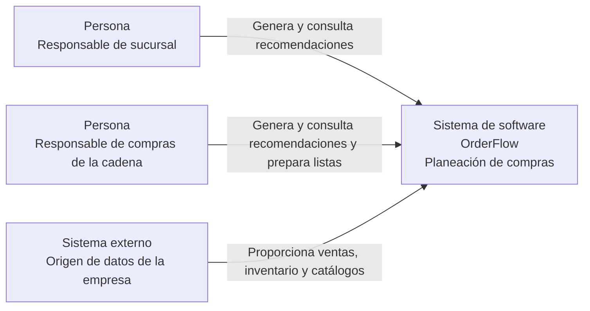
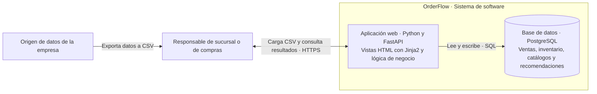
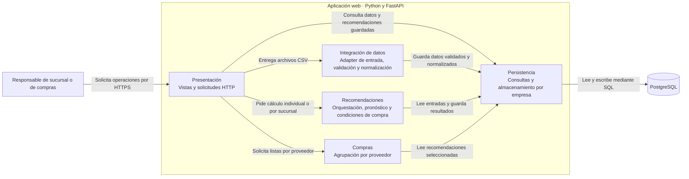

# Arquitectura de OrderFlow

Orden de lectura: [requisitos](../especificacion-requisitos.md), [ADR-001](adr-001-monolito-modular.md) y [modelo UML](modelo-uml.md). Los diagramas describen el diseño propuesto.

## C4 nivel 1 · Contexto

OrderFlow recomienda cantidades de compra para tiendas de abarrotes y embutidos. El usuario solicita el cálculo para un producto o para todo el catálogo de una sucursal. El responsable de compras puede preparar listas por proveedor a partir de las recomendaciones que seleccione. La empresa decide y realiza las compras.

## C4 nivel 2 · Contenedores

La aplicación sirve la interfaz y reúne la lógica de negocio. PostgreSQL guarda datos normalizados y recomendaciones. Para la primera integración se propone que la empresa exporte sus datos a CSV y el usuario cargue los archivos desde la aplicación.

## C4 nivel 3 · Componentes de la aplicación web

La aplicación web contiene cinco componentes. Dentro de **Recomendaciones**, el motor repite la misma operación de cálculo por cada producto solicitado. **Integración de datos** prepara los registros antes de la generación. **Compras** agrupa las recomendaciones seleccionadas en listas que la persona puede revisar.

## Relación con los requisitos

| Componente | Responsabilidad y trazabilidad |
|---|---|
| Presentación | Casos CU-01 a CU-06 y visualización de la justificación y el riesgo (RF-011, RF-012). |
| Integración de datos | Preparación de ventas, inventario, productos, proveedores y sucursales usados en RF-001 a RF-005. |
| Recomendaciones | CU-03, RF-006 a RF-012 y RNF-REN-001. El cálculo usa historial de ventas, inventario y condiciones configuradas para producto y proveedor. |
| Compras | CU-05, RF-013. Agrupa por proveedor e identifica la sucursal de cada partida. |
| Persistencia | Conserva las recomendaciones para CU-04 y permite consultar por sucursal y empresa (RF-014, RF-015). |

La aplicación autentica la sesión según RNF-SEG-001. Persistencia acota las lecturas y escrituras a la empresa asociada a la sesión para aplicar RNF-SEG-002.
