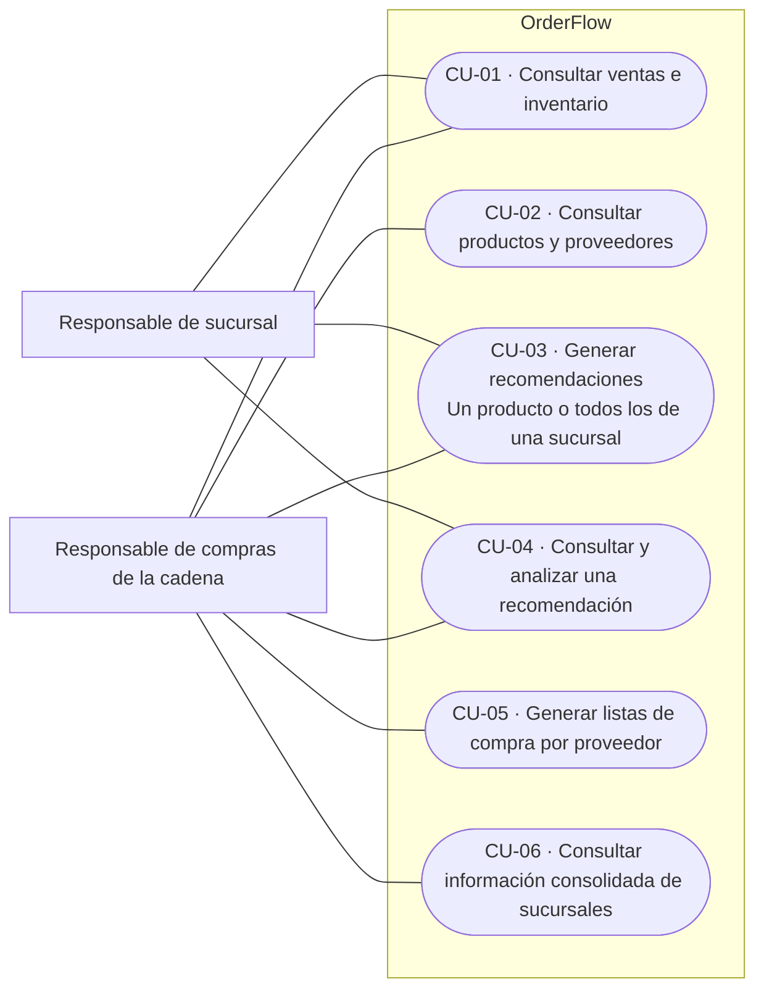

# Casos de uso de OrderFlow

## Diagrama de casos de uso

## Caso principal

La [ficha de CU-03](../especificacion-requisitos.md#53-caso-de-uso-detallado--cu-03-generar-recomendaciones-de-compra) documenta las entradas, el cálculo por producto y los flujos alternos. Las asociaciones del diagrama representan la participación habitual de cada actor.
